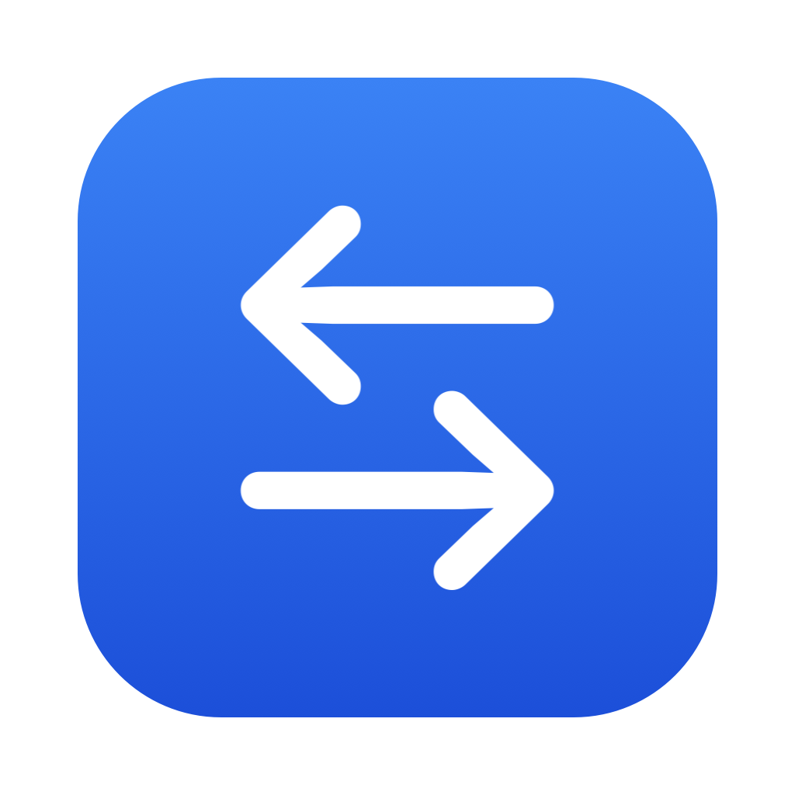

<div align="center">
  

  # Codex Switch

  **方便快速切换 ChatGPT / Codex 账号的 macOS 菜单栏工具**

  不用反复退出登录，也不用手工替换认证文件。菜单栏应用与命令行工具共用同一套账号数据，令牌只保存在 macOS 钥匙串中。

  [](https://www.apple.com/macos/)
  [](https://www.swift.org/)
  [](LICENSE)
  [](https://github.com/bluesky6668/codex-switch/actions/workflows/build.yml)
</div>

---

## 为什么做这个工具

在多个 ChatGPT / Codex 账号之间切换时，反复退出登录既慢又容易打断当前工作。Codex 的登录信息保存在 `~/.codex/auth.json`，手工备份和替换不仅麻烦，也容易把长期有效的刷新令牌留在普通文件、聊天记录或脚本中。

Codex Switch 把切换动作收拢成一个可检查、可撤销的本地流程：

- 令牌存入 **macOS 登录钥匙串**，账号索引只记录邮箱、套餐与时间等非敏感信息。
- 切换前自动回存当前最新令牌，避免 Codex 轮换 `refresh_token` 后保存了失效副本。
- 使用临时文件、`fsync` 和原子替换写入 `auth.json`，写入后重新读取并核对账号身份。
- 拒绝符号链接、异常归属与不安全目录权限，避免把令牌写到意外位置。
- 支持撤销上一次切换；不会强杀 ChatGPT 或 Codex 进程。
- 不提供明文批量导出、账号池、自动轮换、反向代理或公网隧道功能。

> [!IMPORTANT]
> 本项目是独立开发的非官方工具，与 OpenAI 或 Apple 无隶属、授权或背书关系。请仅管理你本人有权使用的账号，并遵守相关服务条款。

## 安全与隐私边界

**本仓库不包含任何真实账号数据、访问令牌、刷新令牌、API Key 或本机数据文件。** 提交前已对源码与待提交文件做凭据特征扫描；测试数据全部为无法用于登录的伪造内容。

运行时的令牌流转被限制在以下范围内：

- **本机存储**：已保存账号的完整认证内容只写入 macOS 登录钥匙串，使用 `ThisDeviceOnly` 属性，不同步到 iCloud。
- **Codex 官方文件**：切换时只在本机钥匙串与 `~/.codex/auth.json` 之间读写；账号索引不含访问令牌、刷新令牌或 API Key。
- **固定官方端点**：查询额度时，访问令牌只发送到 `chatgpt.com`；续期时，刷新令牌只发送到 `auth.openai.com`。客户端拒绝重定向，并使用无 Cookie、无磁盘缓存的临时会话。
- **无额外外传通道**：不含统计分析、遥测、崩溃上报、广告、自动更新服务、远程日志、反向代理或端口监听。
- **输出最小化**：界面与命令行只显示账号标签、邮箱、套餐和额度，不打印令牌或原始 `auth.json` 内容；错误信息也不回显文件内容。
- **明文最小化**：浏览器登录使用权限为 `0700` 的独立临时目录，读取完成后尽力覆写并删除；导入外部文件时可选择导入后删除源文件。

这些措施针对意外提交、普通文件残留、符号链接替换、错误联网目标和日志泄漏等风险。操作系统已被攻破、恶意代码与本程序同权运行，或用户主动复制并泄露 `auth.json` 的场景，不在本工具能够保证的安全边界内。更完整的说明见 [SECURITY.md](SECURITY.md)。

## 功能一览

| 能力 | 菜单栏应用 | 命令行 |
| --- | :---: | :---: |
| 保存当前登录 | ✅ | ✅ |
| 浏览器登录并添加账号 | ✅ | ✅ |
| 搜索、重命名、删除账号 | ✅ | ✅ |
| 一键切换与撤销 | ✅ | ✅ |
| 查看 5 小时 / 每周剩余额度 | ✅ | ✅ |
| 安全检查与权限修复 | ✅ | ✅ |
| 钥匙串存储令牌 | ✅ | ✅ |

## 界面与交互

- **菜单栏**：快速查看账号、当前登录和额度，支持 `⌘1`–`⌘9` 切换。
- **账号页**：显示 5 小时 / 每周剩余额度与重置时间，支持搜索、切换、重命名、复制邮箱和删除。
- **安全检查页**：图形化展示文件归属、目录权限、钥匙串一致性与残留文件检查，可执行安全修复。
- **设置页**：配置应用重启策略、菜单栏显示方式、额度刷新间隔和数据位置。
- **添加账号**：保存当前登录、通过官方 `codex login` 登录，或从指定 `auth.json` 导入并选择是否删除源文件。

主窗口打开时会显示 Dock 图标；点红色关闭按钮后，应用继续驻留菜单栏并自动从 Dock 隐藏。从菜单栏选择“打开主窗口”时，Dock 图标会重新出现。

## 安装

### 直接下载（推荐）

前往 [GitHub Releases](https://github.com/bluesky6668/codex-switch/releases/latest)，下载 `Codex-Switch-*-macOS-universal.zip`。压缩包已经由 GitHub Actions 在线编译，同时支持 Apple Silicon 与 Intel Mac，普通用户**不需要安装 Swift 或 Xcode**。

解压后：

1. 把 `Codex Switch.app` 拖入“应用程序”文件夹。
2. 如果需要命令行工具，再把同目录的 `codex-switch` 复制到自己的 PATH。
3. 当前公开版本采用 ad-hoc 签名，尚未使用 Apple Developer ID 公证。首次打开若被 macOS 拦截，请在 Finder 中右键应用并选择“打开”，确认来源是本仓库后再允许运行。

每个 Release 同时提供 `SHA256SUMS.txt`，可用于核对下载文件是否完整。

### 从源码编译

开发者自行编译时需要 macOS 14 或更高版本，以及 Xcode Command Line Tools（包含 `swiftc`）：

```bash
xcode-select --install
git clone https://github.com/bluesky6668/codex-switch.git
cd codex-switch
./build.sh
```

编译后会生成：

- `.build/Codex Switch.app`：菜单栏应用，可拖入“应用程序”文件夹。
- `.build/codex-switch`：命令行工具，可复制到 PATH 中。

```bash
mkdir -p ~/.local/bin
cp .build/codex-switch ~/.local/bin/
```

应用和 CLI 使用 ad-hoc 签名。每次重新编译后，macOS 可能会再次询问是否允许访问钥匙串；确认程序来自本仓库或你刚刚编译的源码后，可选择“始终允许”。

## 快速开始

```bash
# 保存当前 Codex / ChatGPT 登录
codex-switch import --label 工作号

# 使用官方 codex login 添加另一个账号，不影响当前登录
codex-switch login --label 个人号

# 查看账号；* 表示当前登录
codex-switch list

# 查询所有账号的 5 小时 / 每周额度
codex-switch usage

# 使用序号、标签、邮箱或 ID 前缀切换
codex-switch switch 2

# 撤销上一次切换
codex-switch undo

# 检查并修复安全设置
codex-switch doctor --fix
```

切换时如果 ChatGPT 或 Codex 正在运行，工具会询问是否正常退出并重新打开。非交互环境必须明确使用 `--restart` 或 `--no-restart`。

## 切换流程

```text
读取目标账号 → 钥匙串身份校验 → 检查 ~/.codex 权限
      ↓
正常退出应用（可选）→ 回存当前最新令牌 → 保存撤销快照
      ↓
原子写入 auth.json → 重新读取并核对身份 → 重新打开应用（可选）
```

工具不会强制结束进程。若应用不能在超时前正常退出，本次切换会取消，避免旧登录态在退出时覆盖新写入的 `auth.json`。

## 数据与隐私

| 内容 | 位置 | 说明 |
| --- | --- | --- |
| 账号索引 | `~/Library/Application Support/codex-switch/accounts.json` | 目录 `0700`、文件 `0600`，不含令牌 |
| 账号令牌 | macOS 登录钥匙串 | 服务名 `com.local.codex-switch`，条目名 `acct:<id>` |
| 撤销快照 | macOS 登录钥匙串 | 条目名 `undo` |
| 当前登录 | `~/.codex/auth.json` | Codex 官方使用的认证文件 |

额度查询只访问固定的 `https://chatgpt.com` 与 `https://auth.openai.com`，拒绝重定向，不保存 Cookie，不监听任何端口。

支持以下环境变量：

| 变量 | 用途 |
| --- | --- |
| `CODEX_HOME` | Codex 数据目录，默认 `~/.codex` |
| `CODEX_SWITCH_HOME` | Codex Switch 的账号索引目录 |
| `CODEX_SWITCH_KEYCHAIN_SERVICE` | 钥匙串服务名 |
| `CODEX_SWITCH_CODEX_BIN` | `codex` 命令路径 |
| `CODEX_SWITCH_APP_BUNDLE_IDS` | 需要联动的应用 Bundle ID；设为 `none` 可关闭联动 |

## 测试

```bash
./tests/run.sh
```

测试使用伪造账号、临时目录和独立的钥匙串服务名，不会读取或修改真实的 `~/.codex` 与账号库；结束后会清理测试钥匙串条目。

## 已知限制

- 目前仅支持 macOS 14 及以上版本。
- 查询未使用账号的额度时，如访问令牌已过期，工具会使用其刷新令牌续期并写回钥匙串。同一登录若也在其他设备使用，旧刷新令牌可能因此失效。
- 当前正在使用的账号不会由本工具主动续期，以免 ChatGPT / Codex 被意外登出。
- 若 Codex 配置了 `cli_auth_credentials_store = "keyring"`，它不会读取 `auth.json`，账号切换不会生效；`doctor` 会检查这一项。
- `login` 依赖官方 `codex` 命令；若未单独安装，会尝试使用 ChatGPT.app 或 Codex.app 内置的命令。
- Swift 无法保证擦除内存中的所有令牌副本；APFS 上覆写后删除也不等于物理擦除。核心保护仍依赖钥匙串、文件权限和最小化明文落盘。

## 许可证

[MIT License](LICENSE) © 2026 [bluesky6668](https://github.com/bluesky6668)
